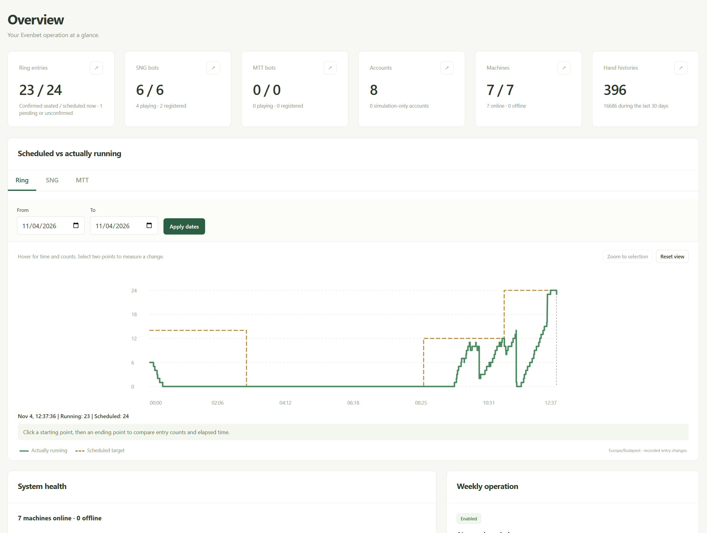

# PokerBackoffice | Operations dashboard

> **Permitted use:** These bots may only be used for research, poker practice in the [simulator](https://github.com/biresevit/simulator-portfolio), poker practice through a real poker-site client, or authorized load testing to assess a poker site's stability under high traffic. Running bots at real-money tables without disclosing their use to all human players is prohibited.

A customer-scoped web dashboard for a distributed poker automation platform, covering schedules, accounts, live tables, hand-history replay, reporting, and machine updates.

## Engineering highlights

- Static HTML/JavaScript frontend and a Python API hosted by Azure Static Web Apps.
- Explicit identity membership, viewer/operator roles, and customer-scoped Azure SQL queries.
- Interactive reporting, replay, live diagnostics, and signed rolling updates.

**Technology:** HTML, CSS, JavaScript, Python, Azure Static Web Apps, Azure SQL, Blob Storage.

## Platform architecture

```text
PokerBackoffice -> Azure SQL <- ScheduleController (Azure Functions)
                                     | commands / telemetry
                                PokerController
                                     | REST
                                  PDecision
                                     |
                         simulator / DecisionMaking
```

[PokerBackoffice](https://github.com/biresevit/PokerBackoffice) | [ScheduleController](https://github.com/biresevit/ScheduleController) | [PokerController](https://github.com/biresevit/PokerController) | [PDecision](https://github.com/biresevit/PDecision-portfolio) | [simulator](https://github.com/biresevit/simulator-portfolio)

## Product view



## Setup and operations

A full deployment requires configured infrastructure, platform accounts, and companion components. The following sections describe setup, validation, and operational requirements.

**Deploying:** see [docs/deploy.md](docs/deploy.md) for every component of the fleet (migrations, scheduler function, backoffice, PC releases, PDecision), in order.

Customer-scoped Azure SQL backoffice with a static HTML/JavaScript frontend and a Python 3.11 Azure Static Web Apps managed API. Deployed at https://lively-rock-032158003.4.azurestaticapps.net on the Free plan, resource group `poker-backoffice`, in the subscription containing `pokerdb`. Do not deploy this API as an independent public Function App: identity headers are trusted only behind the SWA edge.

## Included

- Microsoft sign-in with explicit subject-to-customer membership; viewer/operator roles.
- Account management and session scheduling.
- CSV preview and apply with ownership checks, soft deletion, and protection for live entries and leases.
- Weekly schedule editing, site stake ranges/percentages, machine capacity and allowed sites.
- Lobby-style live table cards with total players/bot entries and a database-configured refresh interval. A user may open a ten-minute, per-bot diagnostic window; only the owning machine responds and only the selected hero's hole cards are exposed.
- Scoped hand-history paging (10/50/100), bot/game/date/blind filters, per-hand hero winnings and human counts, newest/oldest/winnings sorting, all-filtered ZIP downloads, paged bot winnings, and a step-by-step browser replay. Per-player results are calculated once by Azure ingestion and reports are indexed SQL aggregations; opening a replay/download is the only report UI path that reads history blobs.

## Local use

```powershell
.\.venv\Scripts\python.exe tools/build.py
.\.venv\Scripts\python.exe tools/preview.py
# http://127.0.0.1:4280/#overview
```

The preview binds loopback only and uses customer Nenad (14004), with real Azure SQL data. Editing forms persists changes. The preview's identity injection exists only in this local script; it is not deployed.

API settings: `BACKOFFICE_SQL_SERVER`, `BACKOFFICE_SQL_DATABASE`, `BACKOFFICE_SQL_USER`, `BACKOFFICE_SQL_PASSWORD`; TLS certificate verification is mandatory. Local provisioning may instead read the existing `SqlConnectionString`. Blob reads use `BACKOFFICE_HH_CONTAINER_URL` (container URL with read-only SAS) or legacy `StorageConnString`; check `histories.py` for the exact supported configuration before provisioning. Never put secrets in frontend files.

`python-tds` is pinned with pyOpenSSL <26.2 because later releases remove the certificate API it uses. Upgrade these together after verifying TLS compatibility.

## Azure deployment

Current deployment uses SQL user `poker_backoffice_app` with explicit application-table permissions and no customer-registration write permission. Storage uses a read-only container SAS expiring **2027-01-24**. Run `tools/configure_azure.py` before that date to renew it; credentials remain in memory/Azure settings. `tools/deploy.py` bundles the shared planner and publishes through the official SWA CLI with its deployment token passed only through the process environment. Portable deployment tools are under ignored `artifacts/tooling`.

Eight authorized real accounts are configured, and all eight logins were confirmed. Five synthetic accounts remain disabled and never log in. Account additions are idempotent via `tools/add_nenad_accounts.py`.

Use the subscription that contains `pokerdb`. Create a dedicated resource group and the Free Static Web App from `infra/main.bicep`. Free is appropriate for this pilot; consider Standard when an SLA is required. No scheduler timer runs inside the managed HTTP API; deploy that independently as an Azure timer Function when its worker integration is ready.

1. Authenticate Azure CLI, identify the subscription containing `pokerdb`, and select it explicitly.
2. Deploy `infra/main.bicep` to a dedicated resource group in that subscription.
3. Provision a dedicated SQL application user limited to the tables/procedures the API requires. Put its credentials in SWA application settings. Give blob access a read-only container SAS. Do not publish the local admin connection string.
4. Run `tools/build.py` to copy the shared planner into the API (checksums recorded in `api/scheduler-core.json`).
5. With Node and the official Static Web Apps CLI installed, set the deployment token in the process environment `SWA_CLI_DEPLOYMENT_TOKEN` and run:

```text
swa deploy frontend --api-location api --api-language python --api-version 3.11 --env production
```

6. Verify hosted Microsoft login, unauthorized customer rejection, SQL connectivity and the hand-history replay. SQL firewall rules must allow the selected hosting environment; private-only SQL would require a different hosting/networking plan.
7. Sign in as the intended **Microsoft account**, click Request access, then inspect `tools/admin.py requests`. Grant the exact returned subject to Nenad after verifying the identity:

```powershell
.\.venv\Scripts\python.exe tools/admin.py grant --customer Nenad --subject '<exact-userId>' --email '<display-label>' --apply
```

Display name/email alone never grants access. SWA userId is specific to this app; a subject from another application must not be substituted.

## Schema and verification

Scheduler migrations 001 through 005 and backoffice migration 001 are applied in Azure SQL. `002_sessions.sql` records account session start/planned-end/actual-end and relates entries to sessions. `003_live_views.sql` adds the configurable lobby interval and short-lived on-demand table diagnostics. `005_hand_player_results.sql` stores idempotent processing state and per-player results. The other customer's site was not changed. Scheduling and machine assignments remain disabled outside explicitly bounded pilots.

```powershell
.\.venv\Scripts\python.exe -m pytest -q
$env:BACKOFFICE_TEST_SQL='1'
.\.venv\Scripts\python.exe -m pytest -q
# SQL test mutations always roll back.
.\.venv\Scripts\python.exe tools/check_browser.py
```

Browser smoke checks use the running loopback preview; artifacts are ignored. The scheduler suite has 49 passing tests including SQL integration. Backoffice has 19 passing tests including rollback SQL mutations and customer isolation, plus a browser test covering all pages on desktop/mobile.

## Remaining live integration

`ScheduleController.schedule_controller.pilot` now provides a bounded single-PC pilot using the actual planner, authenticated PokerController sessions, SQL command journal/account leases, lobby/seat snapshots, machine heartbeats and account-session lifecycle. It is being live-tested before the eight-account run. It is not yet the distributed Azure queue consumer/timer Function. Outside the bounded pilot, leave scheduling disabled. Allowed-site settings are persisted but do not re-register the current PDecision machine automatically.

Existing pre-Nenad hand histories retain their original customer ownership and are intentionally absent from the Nenad report.

## Table chat

The Chat page lists conversations and currently seated bots for the selected customer/site. Operators can send an explicit message as a selected bot; viewers can read. Incoming messages from known bot accounts are distinguished from human messages. Unread counts are per signed-in user and conversation, with in-app alerts on every page and optional desktop notifications enabled by the user.

The local PokerController worker implements the poker site's chat protocol used in hopperv2. Update both PokerController and ScheduleController, then restart the worker through its seat-preserving recovery flow. A chat heartbeat enables the composer only when that worker is connected. The queue pins each request to the selected entry and worker epoch; duplicate request IDs do not send twice. A send is confirmed by its chat echo. Interrupted or unconfirmed sends are never automatically retried. History does not generate new-message notifications.

Schema: ScheduleController migration `011_table_chat.sql`. No chat text is automatically generated or sent by the scheduler.

## Rolling updates

The Updates page schedules signed PDecision/PokerController releases one PC at a time, with gradual session draining, health verification, traffic recovery and rollback. See [rolling updates](docs/rolling-updates.md) for enrollment, publishing and verification.
