# Poker Control backoffice: user guide

For customers who manage their bots in the backoffice | November 2026

## Signing in and finding your way

Open **pokerfill.com/backoffice** and sign in with your Microsoft account. The first time, you are asked to request access; your administrator then links your account to your customer, and you can sign in from then on.

The menu on the left lists every page. At the top right you choose the **poker site** you are working on; every page shows that site only. If you manage more than one customer, a second list there chooses the customer.

- **Live:** Overview, Live tables, Chat, Sessions and Tasks show what your bots are doing now.
- **Results:** Hand histories and Winnings show what they played and won.
- **Setup:** Accounts, Weekly schedule, Stakes and Strategy settings decide what they play.
- **Fleet:** Machines and Updates show the PCs that run the bots.

> Changes save as soon as you make them, and the scheduler picks them up within about a minute. View-only users can open every page but cannot change anything.

## Overview

Your operation at a glance. The cards at the top show, for right now:

- **Ring entries:** confirmed seats against the number the schedule asks for (for example 23 / 24).
- **SNG and MTT bots:** bots playing or registered in tournaments, against the target.
- **Accounts, Machines and Hand histories:** how many you have, how many PCs are online, and hands uploaded.

**Scheduled vs actually running** compares the schedule (dashed line) with the bots really playing (solid line) for the dates you choose. Click two points on the chart to see the change between them.

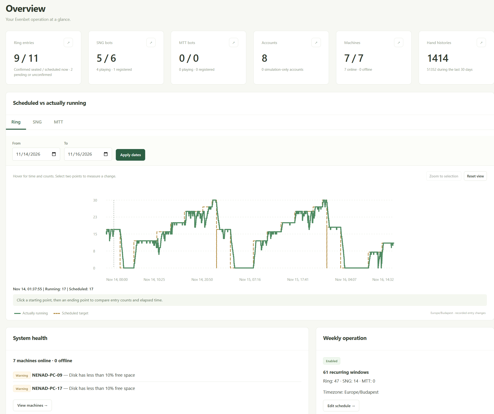

## Live tables

Every table and tournament your bots can see, refreshed every 15 seconds. Filter by game format (ring, SNG, MTT) and table type. Each card shows the players, how many of them are your bots and, for tournaments, who is registered and when it starts.

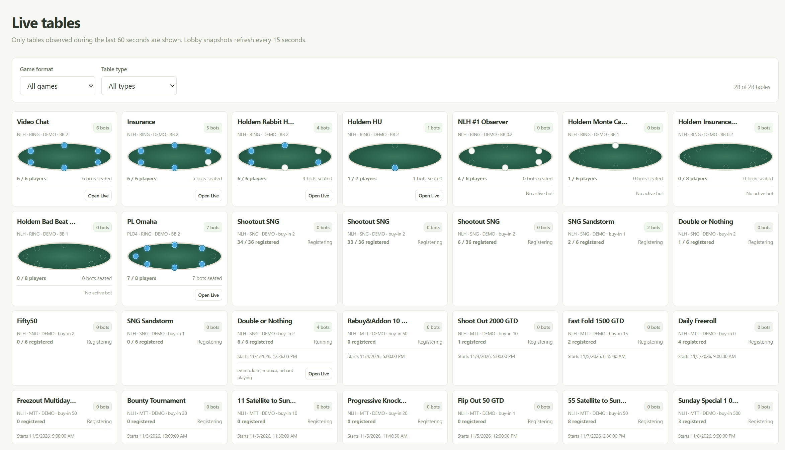

### Watching a table and taking manual control

Click **Open Live** on a table with a bot to watch it in real time. Turn on **Manual control** to play that bot yourself: choose fold, call or raise (keys F, C, R, or the bet-size buttons 1 to 4), or sit out the next hand. Turn it off again and the bot continues automatically. Manual control works on ring tables and in SNG and MTT tournaments.

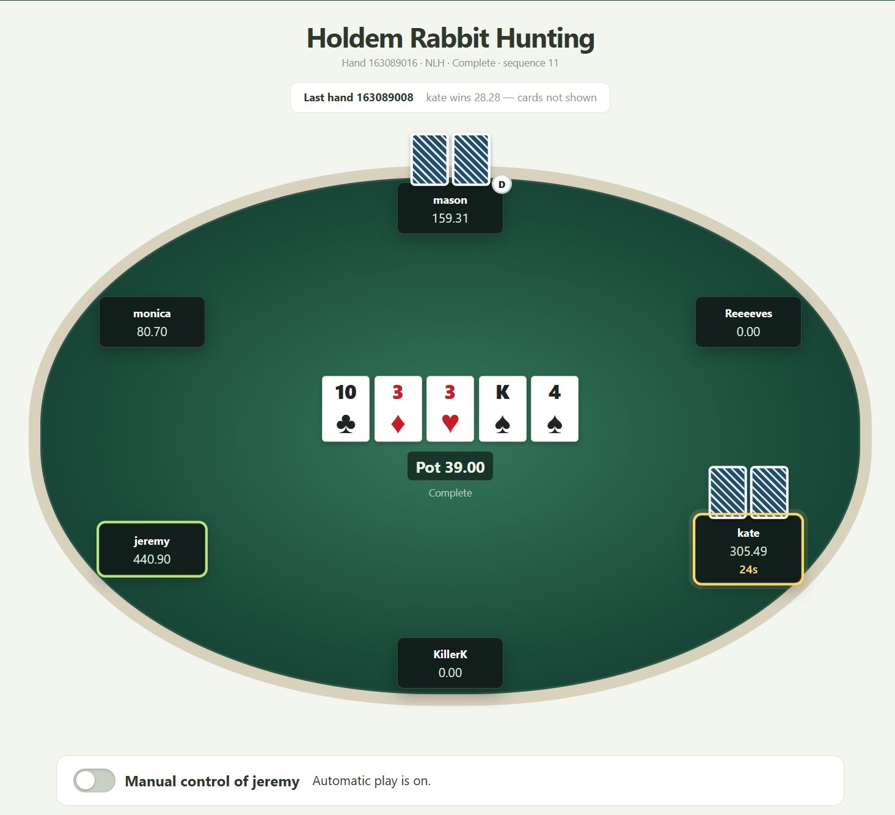

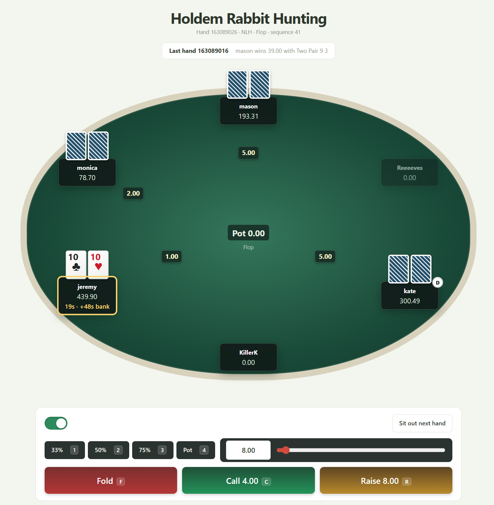

## Chat

Read what is written at your tables and answer through one of your bots seated there. Pick the table on the left, choose **Send as bot**, write the message and click **Send to table**. Messages from human players also show up in the Chat badge at the top of every page; desktop alerts can be turned on or off here.

BluffPoker chat works at cash and tournament tables, with up to 300 characters per message. Messages are live: Poker Control saves those received while a bot is connected; BluffPoker does not supply earlier history. A send is confirmed when its broadcast arrives. Failed or unconfirmed messages are not sent again automatically. The Chat panel in a live table window offers the same controls.

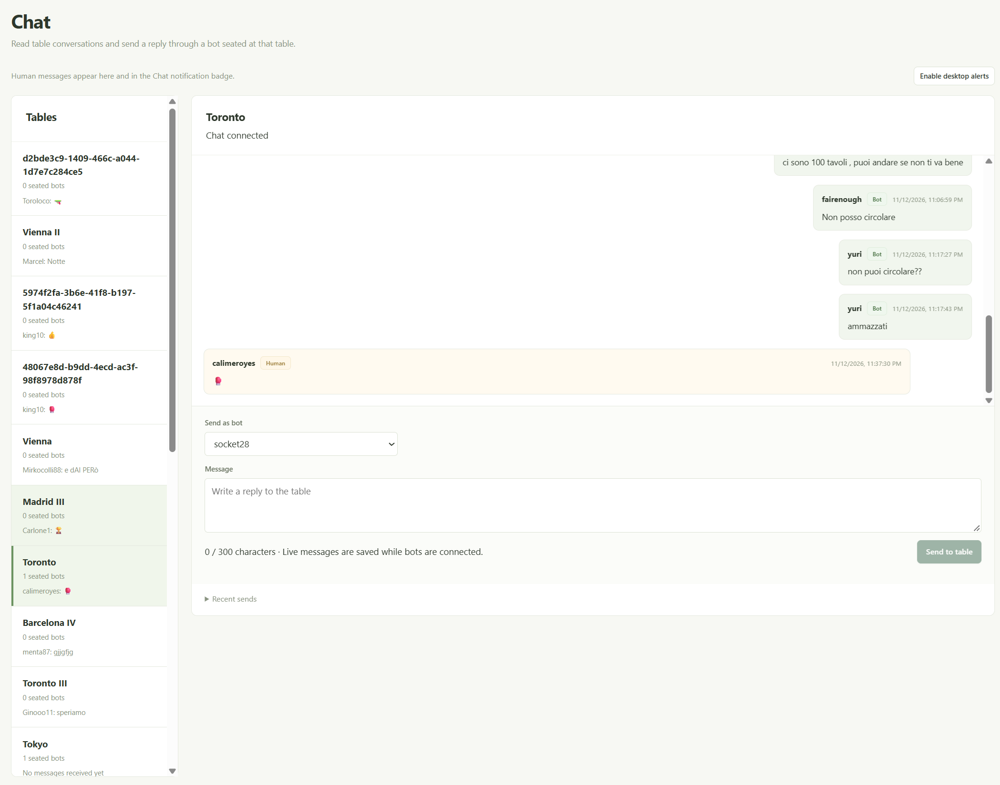

## Sessions

A session is one bot logged in for a period of time; during it the bot joins and leaves tables. The list shows each bot's sessions, the machine running it, its table entries, and planned and actual end. **Stop** ends a session: the bot finishes the current hand and leaves its tables.

A future MTT registration does not keep a playing session open. The bot can register and log out, then start a new session within 30 minutes of the tournament start. Those logins are paced rather than simultaneous. **Register MTT** also works for accounts without an active session: it logs in briefly, registers, and logs out without creating a playing session. Returning to a registration already held is allowed while new joins are paused.

### Starting a session yourself

1. Click **New session**.
2. Choose a bot, or leave **Any available bot**, and a machine.
3. Set start and end (times are in the site's time zone) and click **Create session**.

A manual session always gets its first ring table, and more while the schedule's target is not reached. Its tables count toward the target, so scheduled bots make room for it.

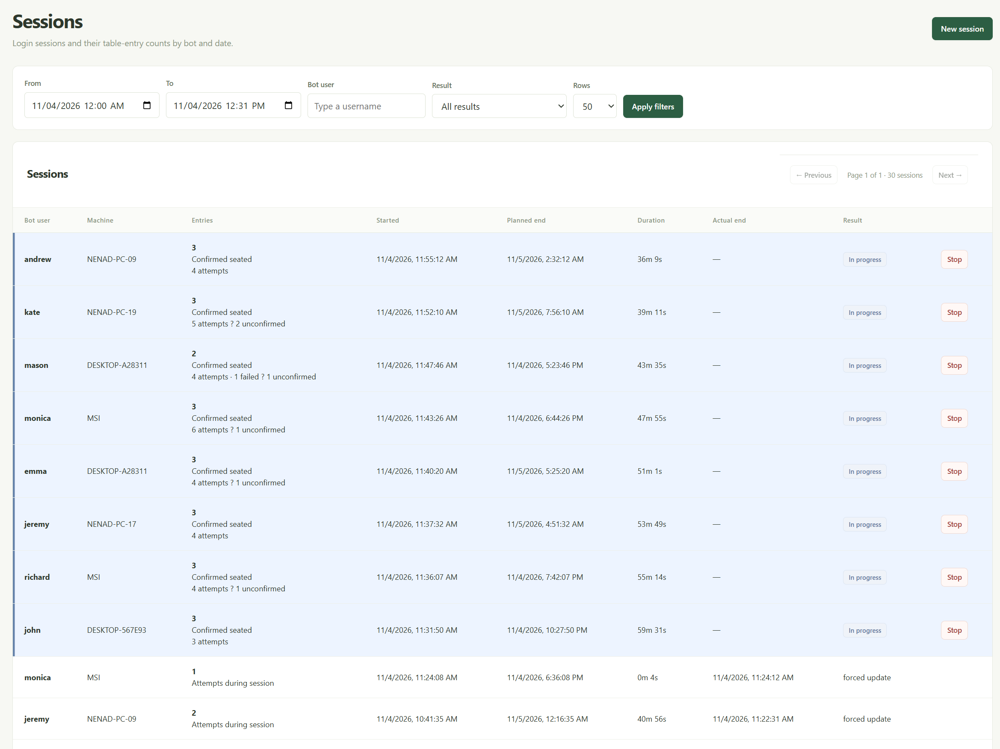

## Tasks

Every action the scheduler or you asked a PC to perform: joining a ring table, registering in an SNG or MTT, leaving. Each task shows its bot, machine, table, status and, if it failed, why. Filter by date, machine, bot, task type, format and status. **New task** lets you order one action yourself, for example registering a chosen bot in a chosen tournament.

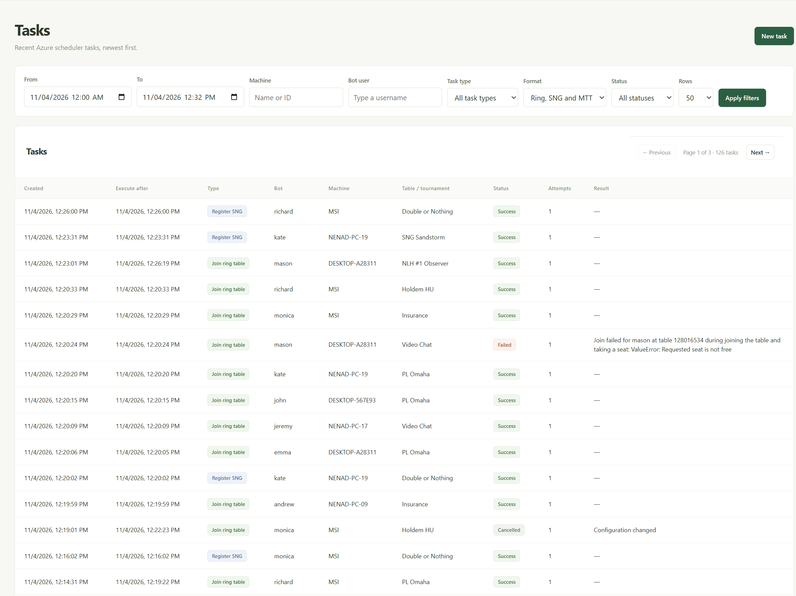

## Hand histories

Every hand your bots played. Filter by dates, bot, game, big blind and sort order, tick the hands you want and click **Download selected**, or click **View hand** to replay a hand street by street. Use **Prev** and **Next** in the replay to step through the hands of your list.

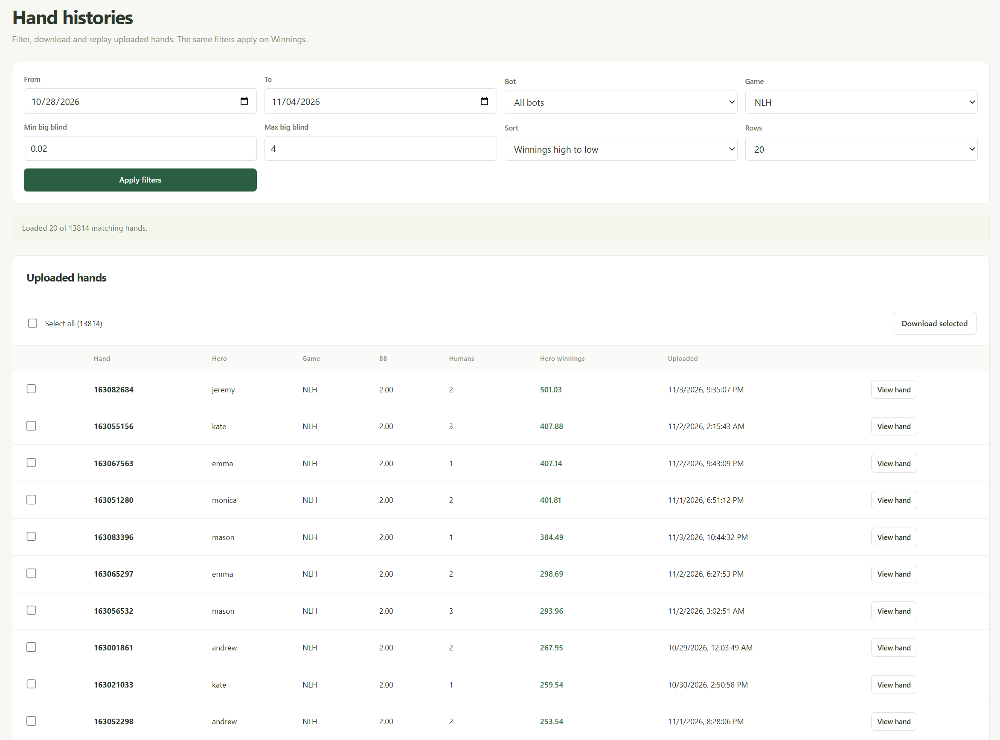

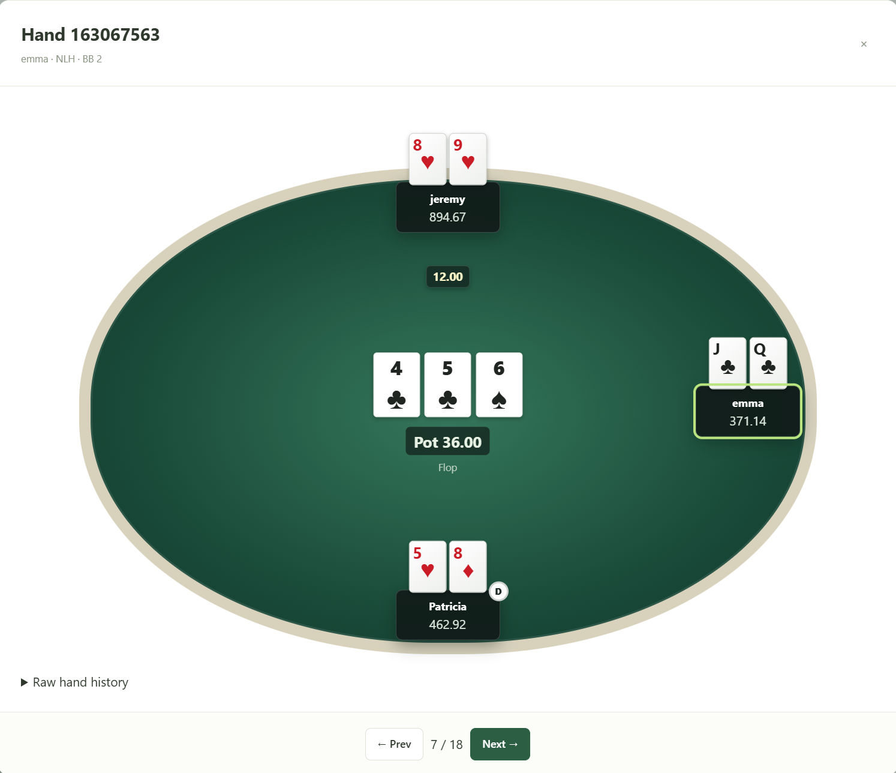

## Winnings

Net winnings per player and game, for the same filters as Hand histories. Choose **Players** to see your bots, the human players they met, or both. The total at the top sums everything matching the filters.

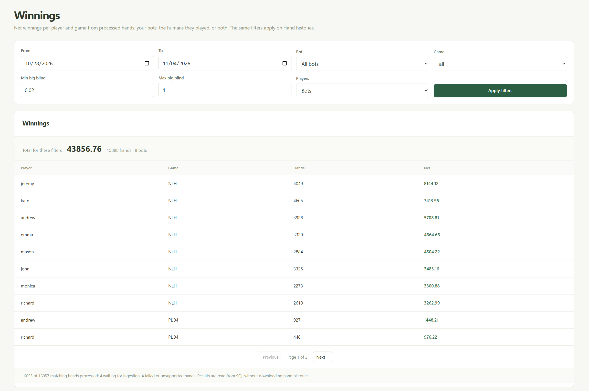

## Accounts

Your bot accounts and their settings. The list shows each account's profile, stake tier, playing frequency, minutes played today against its daily preference, current table entries and status.

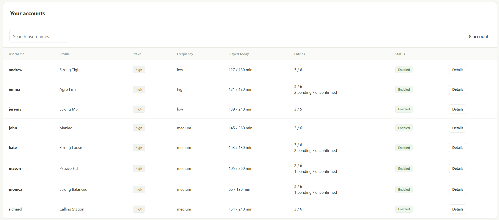

### Adding accounts

Click **+ Add account** for a single account, or **Import CSV** for many. The CSV file's first row names the columns: **username** first, then **password** and **email** (and optionally **profile**), for example:

```
username,password,email
matte_99,Secret-Pass-1,matte_99@example.com
radon_7,Secret-Pass-2,radon_7@example.com
```

1. Click **Import CSV** and choose the file.
2. Choose **Add or update accounts** (or **Replace list** to also delete accounts missing from the file).
3. Click **Preview changes**, check the list, then **Apply preview**.

New accounts are switched on straight away and take their settings from the value distributions below. Bots sign in with the imported email and password. Accounts already used on another site are skipped and marked in the preview.

### Value distributions

Instead of setting every account by hand, say how a setting should be spread, for example "40% low, 40% medium, 20% high" stakes. New accounts follow the distributions automatically. To re-spread existing accounts, click **Apply** on a setting or **Apply to existing accounts...** for several at once.

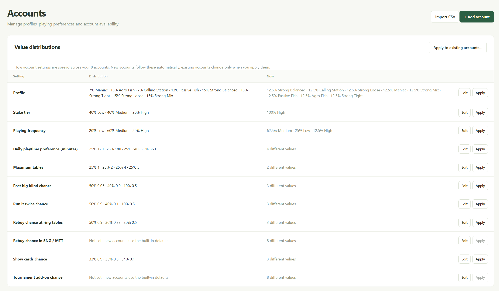

### One account's details

Click **Details** on an account to change its profile, stake tier, playing frequency, daily playtime, maximum tables, chances (posting the big blind, run it twice, rebuys, showing cards, add-ons), session length, breaks and buy-in sizes. You can also switch the account off so the scheduler stops using it.

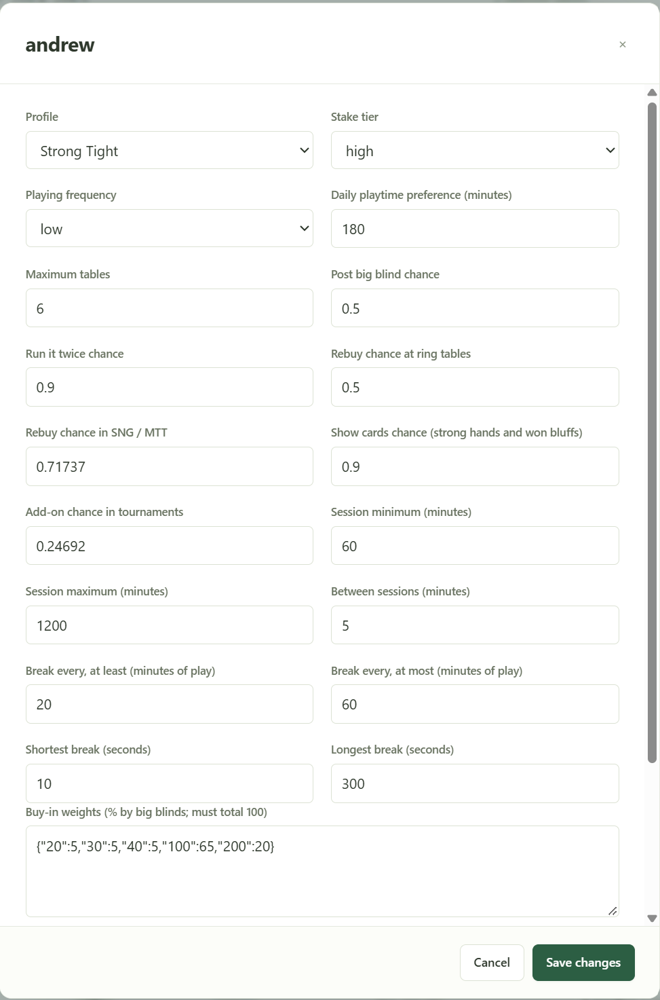

## Weekly schedule

How many bots should play, hour by hour, for each day of the week, separately for **Ring** (seated ring-table entries), **SNG** and **MTT** (bots in tournaments at once). Times are in the site's time zone. Darker blocks mean more bots.

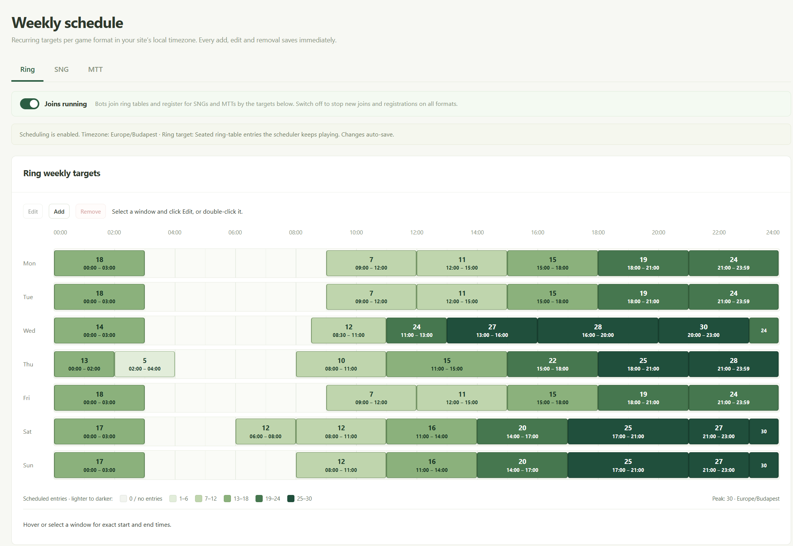

1. Click **Add** above the chart.
2. Pick the days (or **Every day**, **Weekdays**, **Weekend**), a start and end time, and the number of entries.
3. Click **Add and save**. The window stays open so you can add more; click **Done** when finished.

Select a block and click **Edit** (or double-click it) to change it, or **Remove** to delete it.

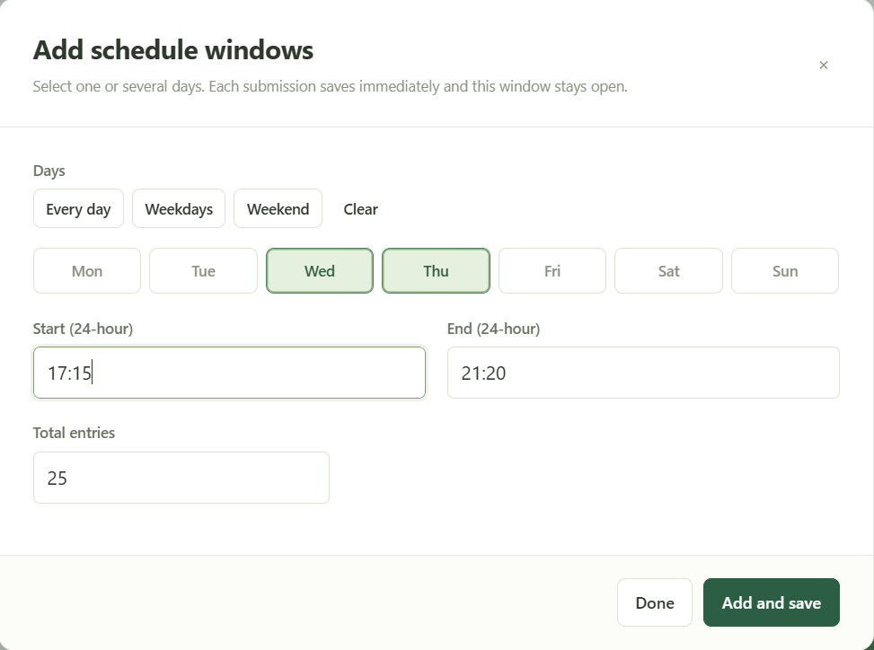

> The switch at the top of the Schedule page pauses all joining and registering for the site: bots already playing carry on and sessions still end on time, but no new tables or tournaments are joined until you switch it back on.

## Stakes and Strategy settings

**Stakes** sets the big-blind range of each stake tier (low, medium, high) for ring tables and tournaments, and the share of the target each tier gets. You can also list tournament names your bots should never join.

**Strategy settings** holds the site-wide playing options, such as whether bots use their strategy against human players and in tournaments. Ask your administrator before changing these.

## Machines and Updates

**Machines** lists the PCs running your bots: whether each is online, its CPU, memory and disk use, its running entries against its capacity, and the software versions. **Logs** collects a PC's logs for troubleshooting.

**Updates** installs new software releases on your PCs. Choose a release and the PCs, then schedule it: normally a PC finishes its sessions first and then updates; **Update immediately** interrupts play straight away.

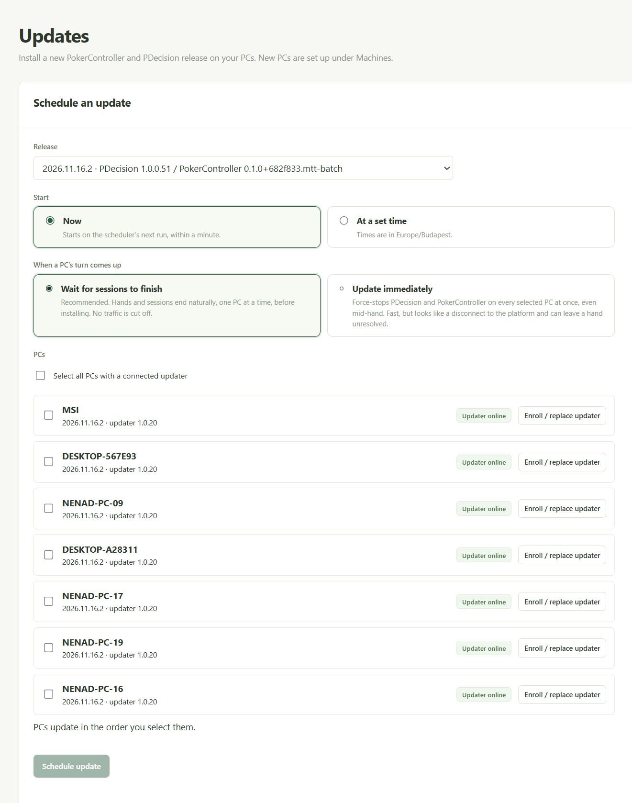

**Past updates** shows how each PC's update went: its status, progress, and start and finish times.

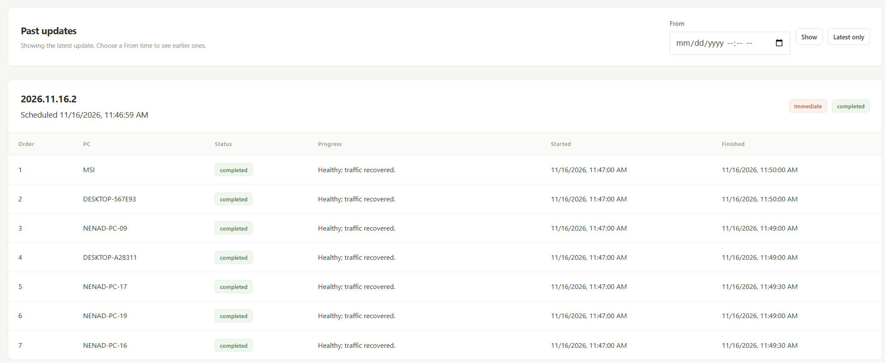

### Adding a new PC

1. On **Machines**, click **Download PokerSuite Setup.exe** and run it on the new PC.
2. Setup shows a pairing code. Send it to your administrator, who approves the PC.
3. The PC then installs the software by itself and appears on Machines. Its bots start once it reports healthy.
